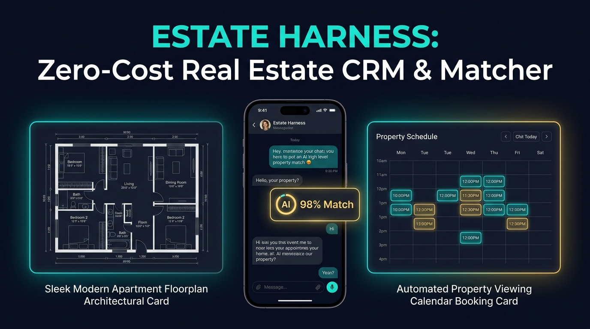

# Estate Harness 🏠📲
**Zero-Cost Real Estate AI Property Matcher & LINE Viewing Booking Engine on Cloudflare Workers + D1 + MCP**



月額5万〜15万円の不動産追客・自動マッチングCRM（ノマドクラウド、KASIKA等）を、**Cloudflare Workers + D1 の完全無料枠（月額0円）**で代替するオープンソースの不動産新着物件AIマッチング＆LINE内見追客エンジンです。

## ✨ 主な特徴
1. **新着物件の希望条件（エリア・予算・間取り）自動マッチング**: レインズやポータルから新着物件を登録した瞬間に、条件合致する見込み客をD1から自動抽出。
2. **LINE内見打診メッセージの即時自動生成**: 駅徒歩・間取り・家賃の魅力を要約し、最短翌日の内見予約を促す文面を自動生成。
3. **AIエージェント（MCP）完全対応**: Claude Code / Cursor から直接物件マッチング状況を確認可能。

## 🚀 クイックスタート
```bash
git clone https://github.com/reina20xx/estate-harness.git
cd estate-harness
npm install
npm run dev
node test-e2e.js
```
## 📄 ライセンス
MIT License
